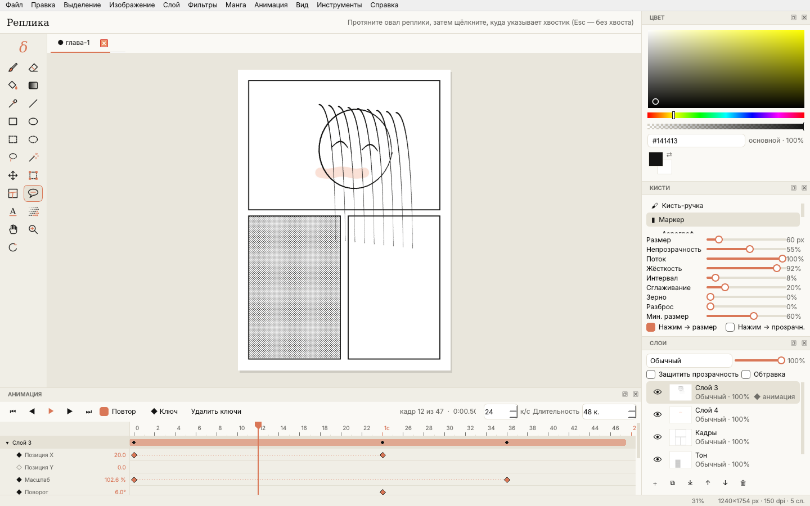
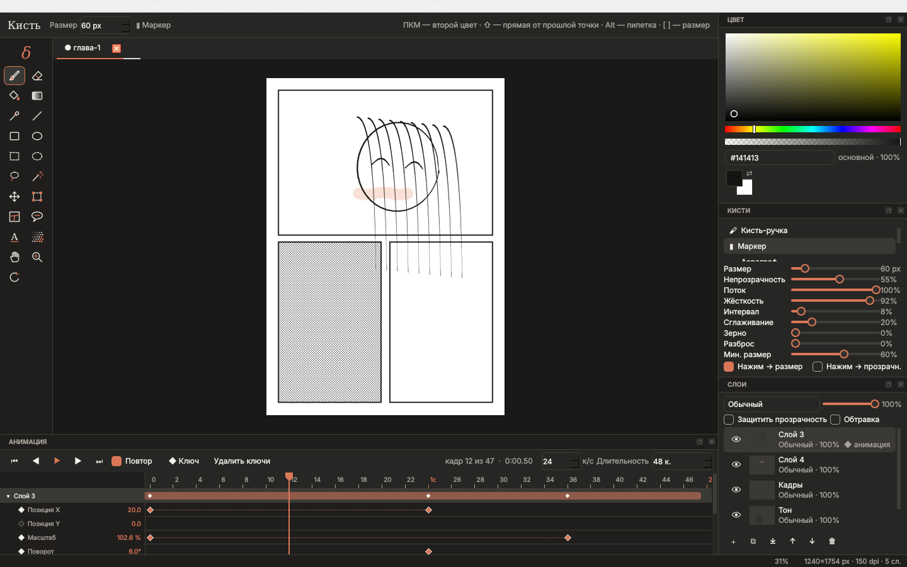

# δ Дельта (Delta)

Программа для **рисования манги, лайт-новелл и персонажей** — в духе Clip Studio Paint / Krita, с анимацией по ключевым
кадрам как в **After Effects**. Для **macOS 11 Big Sur+ (Intel x64)**, интерфейс в стиле Claude — как у
[Каппы](../kappa), [Epsilon](../epsilon), [Ню](../nu) и [Дзеты](../zeta).

- **Кисти** с нажимом пера (Wacom и др.): карандаш с зерном, G-перо для туши, кисть-ручка, маркер (без «накопления»
  внутри мазка), аэрограф, акварель, мел, плоская заливка, ластики, палец (размазывание), размытие. У каждой — размер,
  непрозрачность, поток, жёсткость, интервал, сглаживание (стабилизатор), зерно, разброс, нажим → размер / прозрачность.
- **Слои**: 13 режимов наложения, непрозрачность, защита прозрачности, обтравочные маски, блокировка, миниатюры.
- **Инструменты**: заливка (допуск, «по всем слоям», расширение), градиент, пипетка, линия / прямоугольник / эллипс,
  выделение (прямоугольник, овал, лассо, волшебная палочка), перемещение, свободная трансформация (масштаб, поворот).
- **Манга**: кадры и раскадровка страницы, реплики-пузыри с хвостиком, текст (в том числе вертикальный, с обводкой),
  точечный скринтон (заливкой области или в выделение), извлечение линий из скана.
- **Редактирование картинок**: яркость / контраст, тон / насыщенность / тонирование, уровни, размытие, резкость,
  постеризация, порог, шум, обесцвечивание, инверсия — с живым предпросмотром; размер изображения и холста, поворот,
  кадрирование.
- **Анимация как в After Effects**: композиция (к/с, длительность), у каждого слоя — позиция, масштаб, поворот,
  непрозрачность с ключевыми кадрами и сглаживанием (линейно, ease, ease in/out, hold), начало / конец слоя на таймлайне.
- **Холст**: масштаб, поворот (R, жест трекпада), зеркальный вид, пробел — рука.
- **Файлы**: свой формат `.delta`, OpenRaster `.ora` (Krita / MyPaint / GIMP), экспорт **PSD со слоями**, PNG / JPEG /
  WebP, анимированный **GIF**, **MP4** (если установлен ffmpeg), PNG-последовательность.

Запуск из исходников: `pip install -r requirements.txt && python run.py [файл]`.
Сборка `.dmg`: GitHub Actions (*Дельта — Delta (macOS Intel .dmg)*) или `packaging/build_macos.sh` на Intel Mac.
Дизайн: Figma, скрипты UI-кита и экранов — в [`design/figma`](design/figma).

