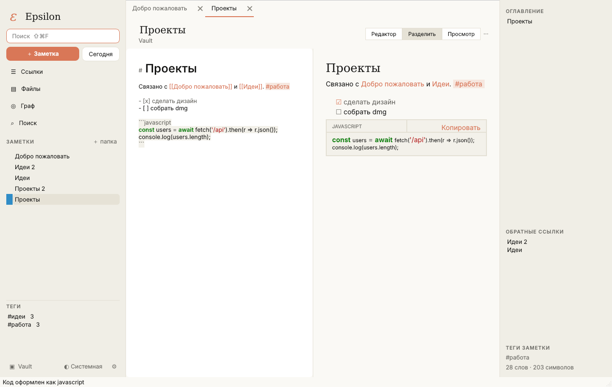
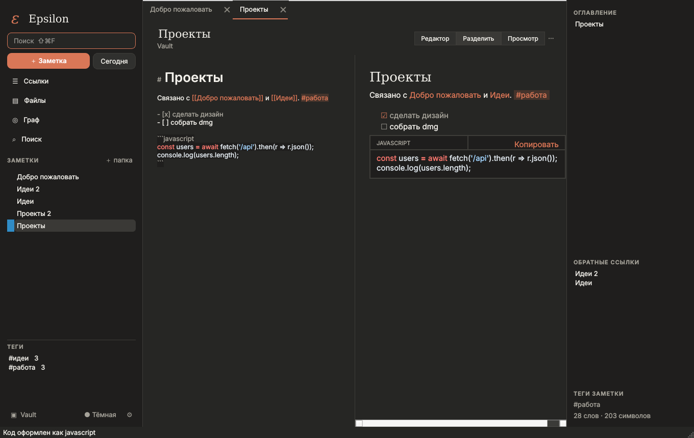

# ε Epsilon

Локальная база знаний в стиле **Obsidian + Notion** для **macOS 11 Big Sur+ (Intel x64)**,
интерфейс в стиле Claude (как у [Amkawa Voice](../amkawa-voice)). Минимум анимаций.

- Хранилище — обычная папка с `.md` файлами; вложения в `attachments/`, закладки в `.epsilon/links.json`,
  корзина `.trash/`. Ничего не уходит в сеть.
- Редактор Markdown с подсветкой (включая код внутри блоков) + просмотр / разделённый режим.
- **Код**: вставляете — язык определяется сам (Python, JS/TS, HTML, CSS, JSON, SQL, Bash, C/C++, Java, C#, Go,
  Rust, Swift, Kotlin, PHP, Ruby, Lua, YAML, Dockerfile…), блок оформляется с подсветкой и кнопкой «Копировать».
- `[[вики-ссылки]]`, обратные ссылки, оглавление, `#теги`, граф связей, быстрый переход ⌘O, поиск ⇧⌘F.
- Notion-подобное: меню блоков по `/`, задачи с чекбоксами, выноски `> [!note]`, таблицы, дневник «Сегодня».
- Файлы: перетаскивание и вставка картинок; раздел «Файлы»; раздел «Ссылки» (закладки с тегами).
- Экспорт в PDF, светлая/тёмная тема.

Запуск из исходников: `pip install -r requirements.txt && python run.py`.
Сборка `.dmg`: GitHub Actions (*Epsilon (macOS Intel .dmg)*) или `packaging/build_macos.sh` на Intel Mac.
Дизайн и UI-kit: Figma, файл «Epsilon — UI».

Figma-скрипты UI-кита и экранов — в [`design/figma`](design/figma).
