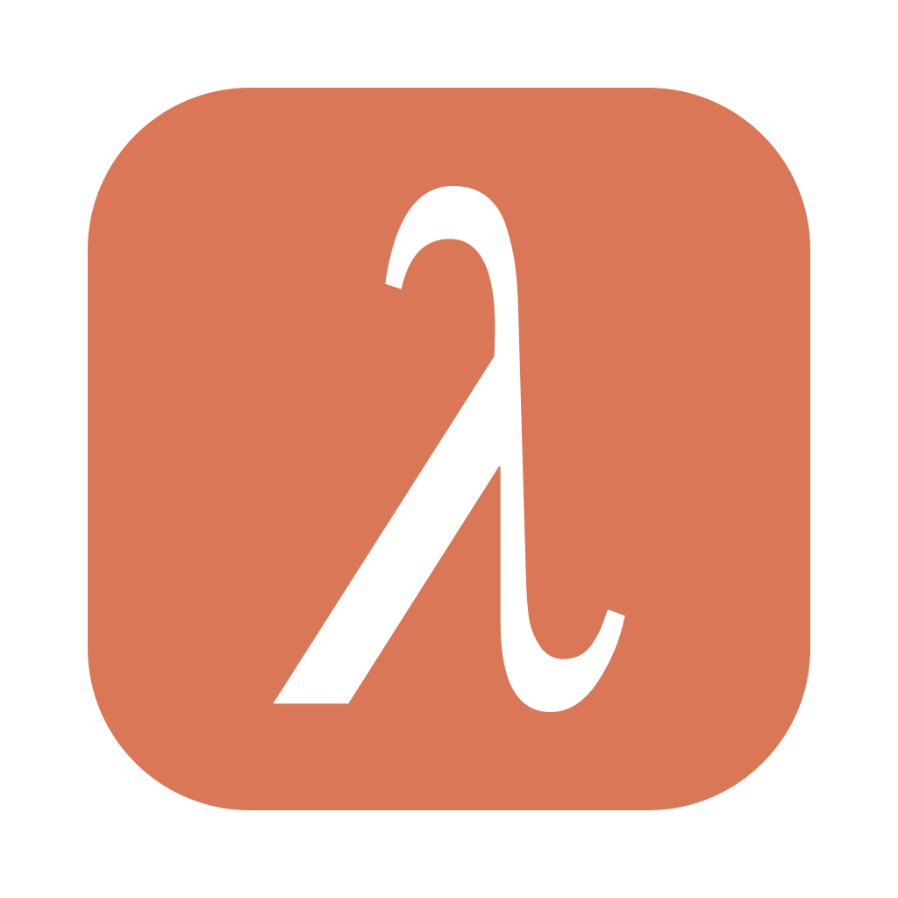

# λ Лямбда

Своя офлайн-«Фигма» для **macOS 11 Big Sur+ (Intel x64)**: интерфейс в стиле Claude
(слоновая кость / уголь, терракота, заголовки с засечками, минимум анимаций), как у [Каппы](../kappa),
[Epsilon](../epsilon), [Ню](../nu), [Дзеты](../zeta) и [Дельты](../delta). Без онлайн-модулей:
никаких аккаунтов, облака, плагинов и публикации — файлы `.lambda` лежат у вас.

Четыре раздела, как в Figma:

| Раздел | Аналог | Что умеет |
|---|---|---|
| **Дизайн** | Figma Design | страницы, фреймы с пресетами устройств, секции, прямоугольники / эллипсы / многоугольники / звёзды, линии и стрелки, перо с кривыми Безье и редактированием точек, карандаш, текст (шрифт, начертание, интерлиньяж, трекинг, авто-ширина / авто-высота), **автолейаут** (направление, отступы, поля, распределение, «обнять» / «заполнить», абсолютные элементы), **компоненты и экземпляры** с переопределениями, группы, маски, булевы операции, «в кривые», обводка в контур, заливки (цвет, линейный / радиальный градиент, изображение), обводки внутри / по центру / снаружи, пунктир, тени, режимы наложения, выравнивание и распределение, умные направляющие, **прототипы** (переходы между фреймами с анимацией) |
| **Доска** | FigJam | бесконечная доска с точками, стикеры 9 цветов (текст сам уменьшается), фигуры с текстом (11 видов), соединители (ломаные, прямые, кривые, с подписями, цепляются к объектам и следуют за ними), маркер и выделитель, секции, штампы-реакции, шаблоны: мозговой штурм, ретро, блок-схема, канбан |
| **Презентация** | Figma Slides | слайды 1920 × 1080, 8 макетов, 6 тем, заметки докладчика, переходы, полноэкранный показ, режим докладчика (текущий / следующий слайд, заметки, таймер), экспорт в PDF |
| **Сайт** | Figma Sites | страницы из 9 готовых блоков (навигация, обложка, преимущества, текст, галерея, отзыв, цены, призыв, подвал), просмотр «Компьютер / Планшет / Телефон» (строки складываются в колонку), ссылки на страницы и адреса, эффекты наведения, предпросмотр в браузере, экспорт папки **HTML + CSS** (flexbox, media-запросы) |

Общее: вкладки как в Figma, главная со всеми шаблонами и недавними файлами (с превью), слои с перетаскиванием,
переименованием и скрытием, неограниченная отмена, копирование между файлами, импорт PNG / JPG / GIF / WebP / SVG
(SVG → редактируемые векторы), экспорт PNG / JPG / WebP / SVG / PDF в 0.5×–4×, светлая и тёмная тема.

## Скачать / собрать

`.dmg` собирается в GitHub Actions (workflow *Лямбда — Lambda (macOS Intel .dmg)*) на Intel-раннере macOS:
вкладка **Actions** → последний запуск → артефакт `Lambda-macOS-x64`. Тег `lambda-v1.0.0` публикует dmg в **Releases**.
Сборка проверяет, что все бинарники x86_64 и требуют macOS ≤ 11.0, и запускает самотест собранного приложения.

Локально: `pip install -r requirements.txt && python run.py` (самотест: `python run.py --selftest`).
Сборка на Intel Mac: `pip install -r requirements-build.txt && packaging/build_macos.sh`.

## Как устроено

| Файл | Что делает |
|---|---|
| `lyambda/model.py` | документ → страницы → узлы, геометрия, автолейаут, компоненты, соединители |
| `lyambda/render.py` | отрисовка: заливки, градиенты, изображения, обводки, стрелки, тени, текст, стикеры |
| `lyambda/canvas.py` | холст: выделение, направляющие, размер / поворот, инструменты, перо, точки, текст |
| `lyambda/inspector.py` | правая панель: свойства, автолейаут, заливки, эффекты, прототип, ссылки, слайды |
| `lyambda/panels.py` | страницы, слои, компоненты, миниатюры слайдов, блоки сайта |
| `lyambda/editor.py` | команды: группы, фреймы, автолейаут, компоненты, булевы, буфер обмена, импорт, экспорт |
| `lyambda/templates.py` | шаблоны, темы и макеты слайдов, блоки сайта, пресеты фреймов |
| `lyambda/svgio.py`, `site.py`, `fileio.py` | SVG экспорт / импорт, сайт → HTML + CSS, файл .lambda, PNG / PDF |
| `lyambda/player.py` | показ прототипа и слайдов, режим докладчика |
| `design/figma/` | UI-кит и экраны Лямбды для Figma-файла «Лямбда — UI» |

Пакет называется `lyambda`, потому что `lambda` — ключевое слово Python.
