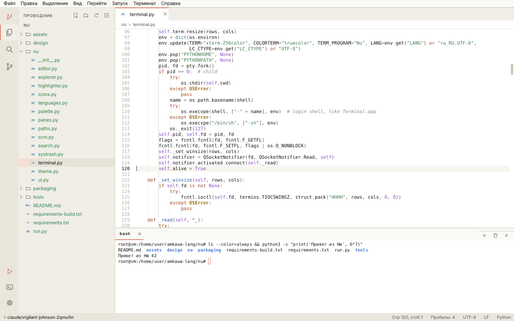
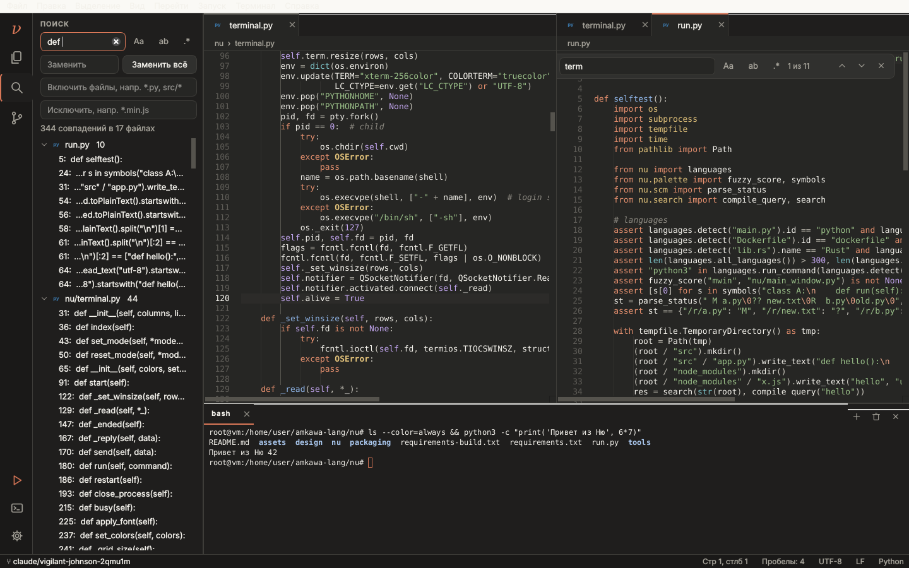

# ν Ню (Nu)

Редактор кода в духе **VS Code / IntelliJ IDEA** для **macOS 11 Big Sur+ (Intel x64)**, интерфейс в стиле Claude —
как у [Amkawa Voice](../amkawa-voice) и [Epsilon](../epsilon). Минимум анимаций.

- **Проводник**: открыть папку или файл, дерево с иконками языков и цветами git, создать / переименовать /
  дублировать / удалить в Корзину, «Показать в Finder», «Открыть в терминале».
- **Редактор**: вкладки, разделение (⌘\), подсветка ~500 языков (Pygments, весь документ — многострочные строки и
  комментарии подсвечиваются верно), номера строк, направляющие отступов, пара скобок, вхождения слова,
  автоотступ и автозакрытие, ⌘/ комментарии, перемещение / копирование строк, автодополнение, поиск и замена
  (регистр, слово, regex), кодировки и LF/CRLF, автосохранение, отслеживание изменений на диске.
- **Терминал**: настоящий shell через pty, эмуляция xterm (pyte): цвета 256/true color, полноэкранные программы
  (vim, htop, less), прокрутка, выделение и копирование; несколько вкладок.
- **Палитра команд** ⇧⌘P, **быстрое открытие** ⌘P, символы файла ⇧⌘O, строка ⌃G.
- **Поиск по файлам** с заменой, фильтрами include / exclude.
- **Git**: ветка, изменённые файлы, diff, «Зафиксировать всё», pull + push.
- **Запуск** F5: Python, Node, Go, Rust, Swift, C/C++, Java, Ruby, PHP, Lua, Shell и др. — в терминале.
- Расширений пока нет (нет хостинга для них) — всё нужное встроено.

Запуск из исходников: `pip install -r requirements.txt && python run.py [папка]`.
Сборка `.dmg`: GitHub Actions (*Ню — Nu (macOS Intel .dmg)*) или `packaging/build_macos.sh` на Intel Mac.
Дизайн: Figma, скрипты UI-кита и экранов — в [`design/figma`](design/figma).

Лицензии: терминальная эмуляция — [pyte](https://github.com/selectel/pyte) (LGPL-3.0), подсветка — Pygments (BSD).
