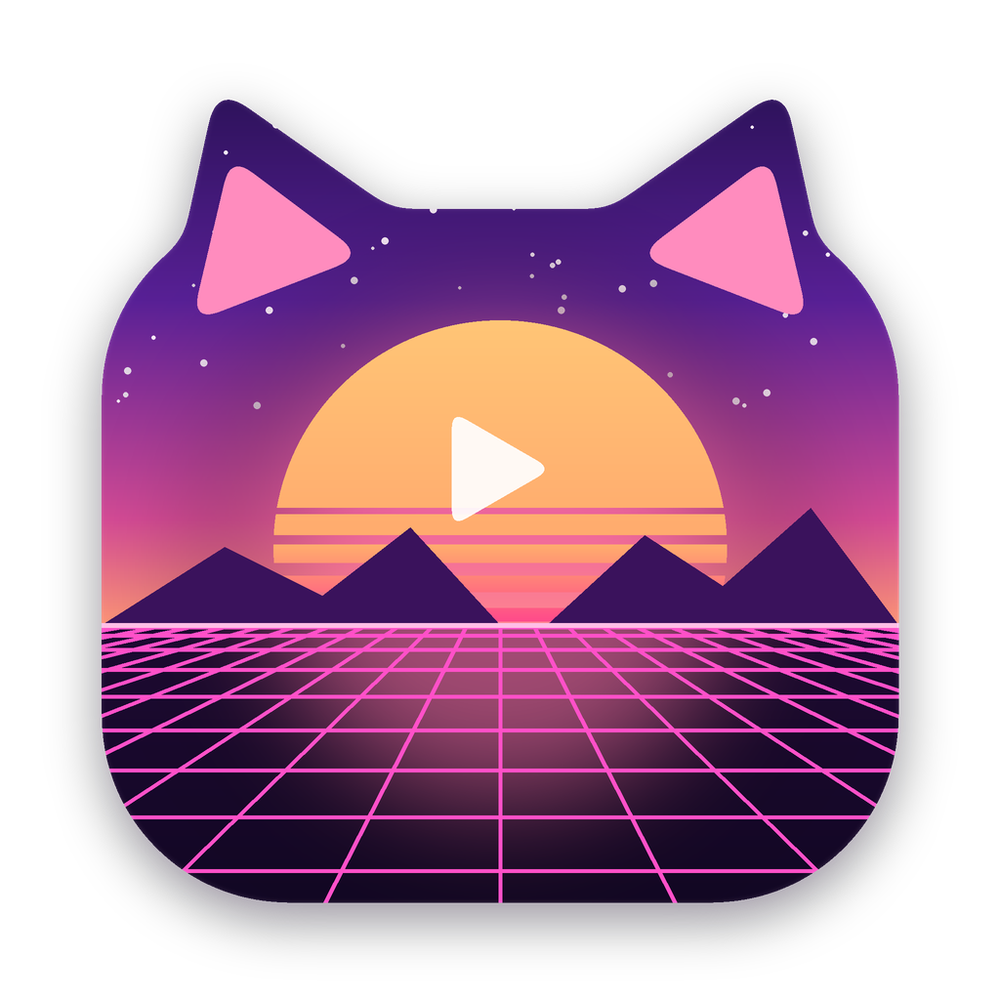

# TnQkoWallpaper

Живые обои из видео для macOS 11+ на Intel. Принцип как у Wallpaper Engine: выбираешь ролик, и он
по кругу играет вместо картинки рабочего стола, со звуком или без.



## Как это работает

На каждом экране открывается окно без рамки на уровне рабочего стола (`kCGDesktopWindowLevel`).
Оно лежит под иконками, есть на всех Spaces и не перехватывает мышь. Видео идёт через `AVQueuePlayer` +
`AVPlayerLooper`: один плеер на все экраны, поэтому звук не двоится. Аппаратное декодирование H.264 /
HEVC берёт на себя macOS.

- **Библиотека:** перетащи видео в окно или нажми «Добавить видео…»; клик по карточке ставит обои.
- **Звук:** выключен по умолчанию, включается галочкой, есть громкость.
- **Масштаб:** заполнить экран (с обрезкой), вписать целиком, растянуть.
- **Экраны:** все или только главный; подключение и отключение мониторов отслеживается.
- **Экономия:** пауза при работе от батареи, когда другое окно развёрнуто на весь экран, и пока экран спит.
- **Обычные обои:** кадр видео ставится картинкой рабочего стола (видно в Mission Control и после выхода);
  «Убрать обои» возвращает прежнюю картинку.
- **Автозапуск:** LaunchAgent в `~/Library/LaunchAgents` (программа должна лежать в «Программах»).
- Значок в строке меню: пауза, звук, быстрый выбор из библиотеки, выход.

## Сборка

```bash
packaging/build_macos.sh          # swiftc → .app → --selftest → dist/*.dmg
packaging/make_icon.py            # перерисовать иконку (Pillow)
```

Нужны только Xcode Command Line Tools, внешних зависимостей нет. CI:
`.github/workflows/tnqko-macos.yml` собирает на каждый push в `tnqko/` и публикует релиз по тегу
`tnqko-v*` или по `workflow_dispatch` с `release_version`.
