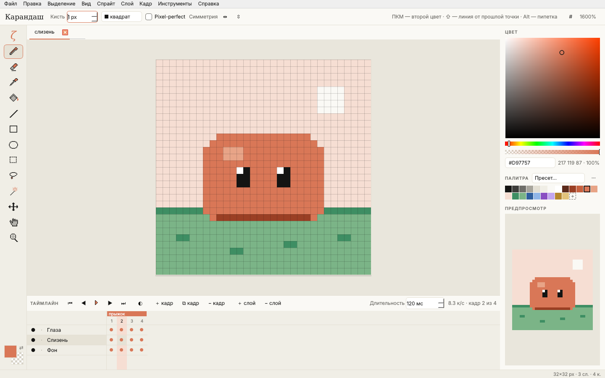
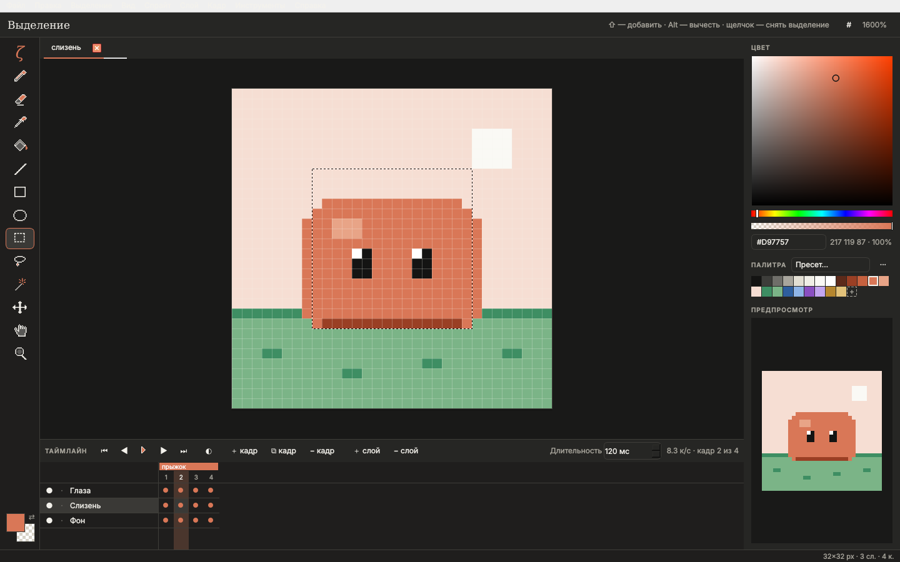

# ζ Дзета (Zeta)

Редактор **пиксель-арта и анимации** в духе [Aseprite](https://www.aseprite.org/docs/) для **macOS 11 Big Sur+ (Intel x64)**,
интерфейс в стиле Claude — как у [Каппы](../kappa), [Epsilon](../epsilon) и [Ню](../nu).

- **Спрайт**: слои (видимость, блокировка, непрозрачность, 13 режимов наложения) × кадры (длительность каждого),
  метки анимации (вперёд / назад / пинг-понг), палитра.
- **Инструменты**: карандаш (pixel-perfect, кисть квадрат / круг 1–64 px), ластик, пипетка, заливка (смежная / глобальная,
  допуск), линия, прямоугольник, эллипс (контур / заливка), выделение, лассо, волшебная палочка, перемещение,
  рука, масштаб; симметрия по горизонтали и вертикали; ПКМ — второй цвет, Alt — пипетка, пробел — рука.
- **Таймлайн**: слои × кадры, кальки (onion skin), проигрывание с учётом меток, перетаскивание кадров.
- **Цвет**: HSV-пикер, HEX, альфа; палитры DB32, PICO-8, Sweetie 16, Endesga 32, Game Boy, Claude, загрузка и
  сохранение .gpl / .hex / .pal, «цвета из спрайта».
- **Правка**: отмена / повтор, копировать / вырезать / вставить (и как новый спрайт), отражение, поворот,
  размер холста и спрайта, обрезка, замена цвета, инверсия.
- **Файлы**: родной формат — **.aseprite / .ase** (открываются и сохраняются совместимо с Aseprite, включая метки,
  индексные и серые спрайты, связанные ячейки); импорт PNG / GIF / JPEG / BMP; экспорт PNG, анимированный GIF,
  спрайт-лист PNG + JSON (формат Aseprite), последовательность PNG, с масштабом.

Запуск из исходников: `pip install -r requirements.txt && python run.py [файл]`.
Сборка `.dmg`: GitHub Actions (*Дзета — Zeta (macOS Intel .dmg)*) или `packaging/build_macos.sh` на Intel Mac.
Дизайн: Figma, скрипты UI-кита и экранов — в [`design/figma`](design/figma). Иконка — пиксельная ζ (`tools/make_icon.py`).

